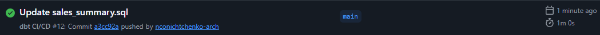

# dbt CI/CD Demo

Демонстрация настройки **CI/CD для dbt-проекта** с использованием GitHub Actions.

## Что это такое?

**CI/CD для данных** — это автоматическая проверка dbt-моделей при каждом изменении кода. Если модель содержит ошибку (например, ссылается на несуществующую таблицу), CI/CD блокирует изменения и не дает им попасть в основную ветку.

Это предотвращает ситуацию, когда «сломанный» SQL ломает весь пайплайн.

## Что реализовано

- **dbt-модель** `sales_summary.sql`: агрегация продаж по дням (количество заказов и сумма выручки).
- **dbt-тесты** (`schema.yml`): проверка на `not_null` и `unique` для ключевых полей.
- **GitHub Actions** (`.github/workflows/dbt-ci.yml`): автоматический запуск `dbt run` и `dbt test` при каждом пуше.
- **Временная PostgreSQL** в GitHub Actions: создается таблица `fct_sales` с тестовыми данными, чтобы модель могла выполниться.

## Стек

- dbt-core (dbt-postgres)
- PostgreSQL
- GitHub Actions

## Как это работает

1. При пуше в `main` GitHub Actions запускает workflow.
2. Поднимается временная PostgreSQL (через `services`).
3. Создается схема `dbt_schema` и таблица `fct_sales` с тестовыми данными.
4. Запускается `dbt run` (выполнение модели).
5. Запускается `dbt test` (проверка качества данных).

Если модель содержит ошибку — workflow падает с красным крестиком. Если всё хорошо — зеленым.

## Скриншоты

**Успешный запуск (зеленая галочка):**

**Запуск с ошибкой (красный крестик):**

## Ссылки

- [Основной проект DWH Marketplace Analytics](https://github.com/nconichtchenko-arch/marketplace-dwh-analytics)
- [Data Contracts Demo](https://github.com/nconichtchenko-arch/data-contracts-demo)
